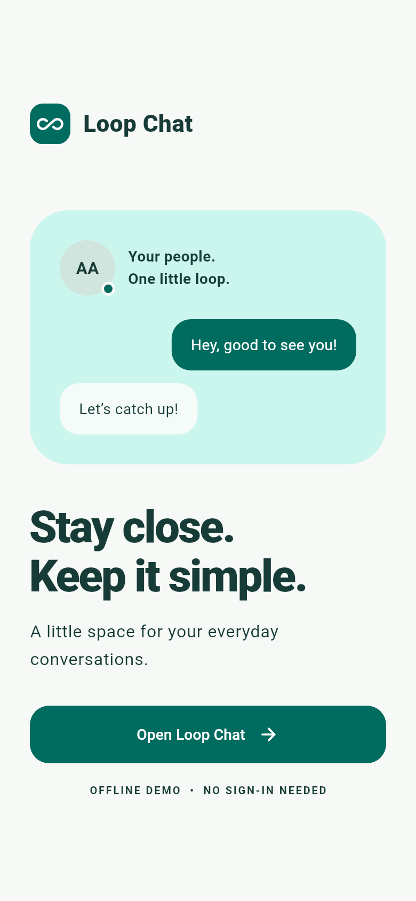

# Loop Chat

A modern, responsive, offline-first Flutter chat application built with Material 3. Features WhatsApp-style phone authentication onboarding, local data persistence, a responsive two-pane desktop/tablet layout, rich chat interactions, and customizable theme accent palettes.



---

## 🌟 Architecture & Project Overview

**Loop Chat** is architected to operate completely offline without requiring cloud servers, Firebase, or external network backends. State and message history are managed cleanly via a central `ChangeNotifier` store (`DemoStore`) and persisted locally using `SharedPreferences`.

### 📁 Directory Structure

```text
lib/
  main.dart                    Application Entry Point
  app.dart                     Root MaterialApp, Theme Configuration & Session Routing
  theme.dart                   Material 3 Theme Builder & 5 Accent Color Palettes
  demo_store.dart              Central State Manager & SharedPreferences Persistence
  screens/
    auth_screen.dart           WhatsApp-Style Phone Number & OTP Verification Onboarding
    welcome_screen.dart        Animated Welcome Landing Screen with Session Details
    home_screen.dart           Responsive Two-Pane / Single-Pane Chat & People List
    chat_screen.dart           Conversation UI with In-Chat Search, Copy/Delete & Haptics
    settings_screen.dart       Profile Editor, Theme Accent Picker & Sign Out
  widgets/
    shared.dart                Avatars, Infinity Logo, Relative Time Labels & Page Transitions
```

---

## ⚙️ Key Subsystems & Features

### 📱 1. WhatsApp-Style Phone & OTP Authentication (`AuthScreen`)
- **Country Selection Picker**: Supports multiple countries (Pakistan 🇵🇰, USA 🇺🇸, UK 🇬🇧, India 🇮🇳, UAE 🇦🇪, Saudi Arabia 🇸🇦, Canada 🇨🇦, Australia 🇦🇺) with flags and dial codes.
- **Country-Specific Digit Validation**: Enforces exact required digit counts per country:
  - **Pakistan 🇵🇰 (+92)**: 11 digits
  - **United States 🇺🇸 / Canada 🇨🇦 (+1)**: 10 digits
  - **United Kingdom 🇬🇧 (+44)**: 10 digits
  - **India 🇮🇳 (+91)**: 10 digits
  - **UAE 🇦🇪 (+971)** / **Saudi Arabia 🇸🇦 (+966)**: 9 digits
  - **Australia 🇦🇺 (+61)**: 9 digits
- **Error Feedback**: Displays instant form validation error messages if phone number or OTP fields are left empty or contain incorrect digit lengths.
- **Two-Step Onboarding**: Phone number entry $\rightarrow$ 6-digit OTP verification code step.
- **Session Persistence**: Stores login state (`is_logged_in`, `phone_number`, `country_code`) in `SharedPreferences` so users stay logged in across app restarts.
- **Sign Out Flow**: One-tap **Sign Out** in Settings clears session credentials and returns directly to `AuthScreen`.

---

### 🖥️ 2. Two-Pane Responsive Layout (`HomeScreen`)
- **Desktop & Tablet ($\ge 760\text{px}$)**:
  - Displays a **Master-Detail Split-View** layout.
  - **Left Pane (380px)**: Shows the `NavigationRail` and searchable conversation list.
  - **Right Pane**: Displays the active `ChatScreen` embedded inline (or an `EmptyState` prompt if no contact is selected).
- **Mobile ($< 760\text{px}$)**:
  - Uses a single-pane layout with a Material 3 bottom `NavigationBar`.
  - Tapping a contact pushes `ChatScreen` as a full-screen route with smooth custom transitions (`loopRoute`).

---

### 💬 3. Rich Chat Experience (`ChatScreen`)
- **In-Chat Message Search**: Search and filter messages inside any conversation in real time via the AppBar search action.
- **Long-Press Bubble Context Menu**: Long-pressing any message bubble triggers tactile haptic feedback (`HapticFeedback.lightImpact()`) and presents options to:
  - **Copy Message**: Copies text to system clipboard (`Clipboard.setData`).
  - **Delete Message**: Removes the message from state and updates local storage.
- **Relative Timestamps**: Dynamic timestamp formatting (*"Just now"*, *"5m ago"*, *"14:05"*, *"Yesterday 14:05"*, *"Oct 18"*).
- **Auto-Scroll**: Smoothly animates the list to the bottom upon sending or receiving messages.
- **Simulated Replies**: When enabled, sending a message triggers typing indicators and generates an automated sample reply after 1.4 seconds.

---

### 🎨 4. Theme Customization & Design System (`LoopTheme`)
- **Material 3 System**: Dynamically builds `ThemeData` using `ColorScheme.fromSeed` seeded with the selected accent palette.
- **Theme Modes**: Supports **System Default**, **Light Mode**, and **Dark Mode**.
- **5 Accent Color Palettes**: Choose between **Teal**, **Indigo**, **Rose**, **Amber**, and **Emerald** from the Settings screen.

---

### 💾 5. Local Data Persistence (`DemoStore`)
- Uses `SharedPreferences` to serialize app state and message history locally as JSON (`messages_<contact_id>`, `favorites`, `user_name`, `user_bio`, `is_logged_in`).
- Automatically loads stored preferences on startup and persists every state mutation (`send`, `deleteMessage`, `updateProfile`, `toggleFavorite`, `logout`).

---

## 🚀 Getting Started

### Prerequisites

- Flutter SDK **3.35.7 or newer**
- Dart SDK **3.9.2 or newer**

### Installation & Run

1. Clone or navigate to the project directory:
   ```sh
   cd loop_chat
   ```

2. Fetch dependencies:
   ```sh
   flutter pub get
   ```

3. Run the application:
   ```sh
   flutter run
   ```

#### Platform Targets:

- **Web Browser**:
  ```sh
  flutter run -d chrome
  ```
- **Android Release APK**:
  ```sh
  flutter build apk --release
  ```
  *(Output location: `build/app/outputs/flutter-apk/app-release.apk`)*
- **Linux Desktop**:
  ```sh
  flutter run -d linux
  ```

---

## 🧪 Testing & Verification

Run static analysis and the automated test suite:

```sh
# Static code analysis
flutter analyze

# Run unit & widget tests
flutter test

# Regenerate preview screenshots
flutter test test/preview_test.dart --dart-define=CAPTURE_PREVIEWS=true
```

---

## 📸 Screenshots & Previews

Generated widget preview captures are saved under `docs/screenshots/`:
- `welcome.png`
- `chats.png`
- `conversation.png`
- `profile-dark.png`
- `desktop-dark.png`

---

## 📄 License & Credits

Adapted and enhanced from Huraira's original prototype. Free to use and modify.
